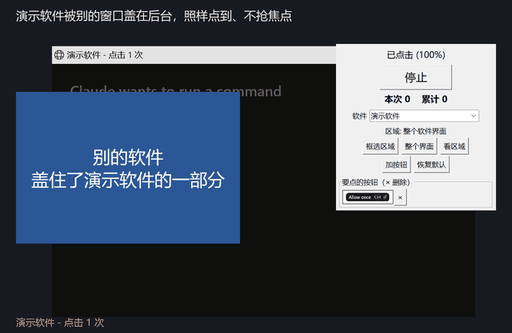
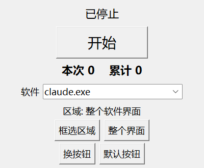
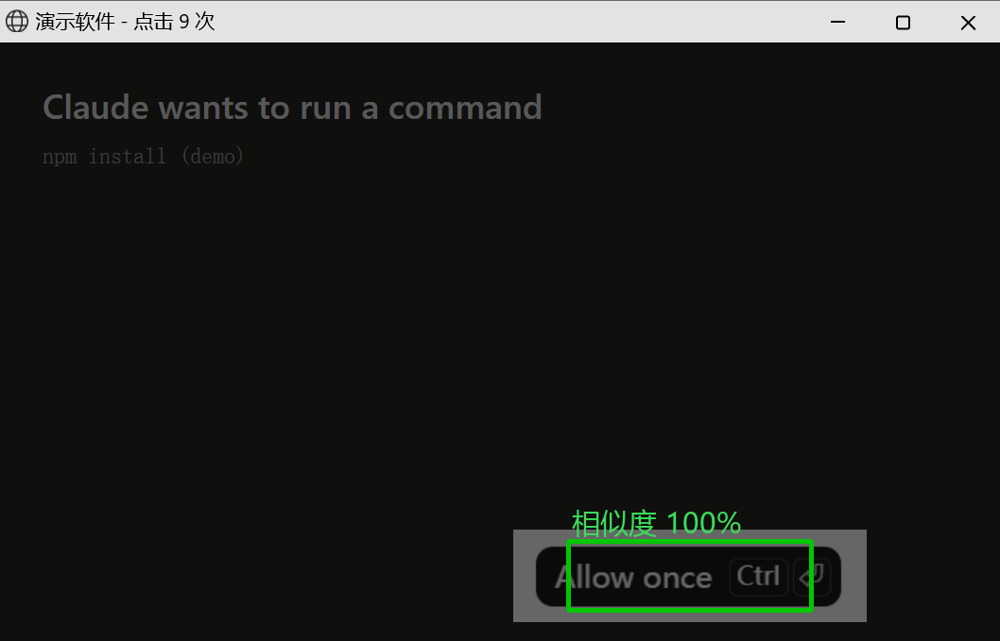

# 自动点击

在软件界面里找到和你给的截图 **≥80% 相似** 的地方，自动点一下。玩游戏、点确认按钮都行。



- 软件在后台、被别的窗口盖住也能点（不动真实鼠标）
- **不会把软件拉到前台**，不抢你正在用的窗口
- 界面显示 **本次** 点击数和 **累计** 点击数
- 可框选只检测的区域；支持 Chromium 系软件（Claude、Edge、Chrome…）和普通窗口

## 使用
1. 下载 Release 里的 `自动点击.exe`，双击。
2. 「软件」下拉选要点的软件（也可手填进程名或窗口标题关键字）。
3. 点「换按钮」，在软件上框出要点的按钮。点「默认按钮」可恢复。
4. 点「开始」。需要时点「框选区域」缩小检测范围。

## 效果
| 界面 | 检测 |
|---|---|
|  |  |

视频：[docs/demo.mp4](docs/demo.mp4)

## 原理
`PrintWindow` 截取窗口（被遮挡也行）→ 多尺度模板匹配（纯 numpy + FFT，不依赖 OpenCV，exe 仅 17MB） → `PostMessage` 向窗口投递鼠标消息。

## 测试
```
python tests/e2e_background.py   # 后台点击
python tests/e2e_focus.py        # 不抢焦点（每 10ms 采样前台窗口）
```
测试会弹出演示窗口，约 15 秒。

## 许可
MIT
