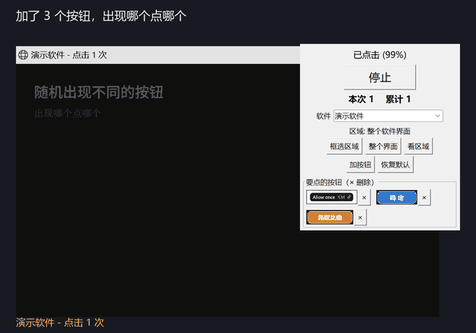
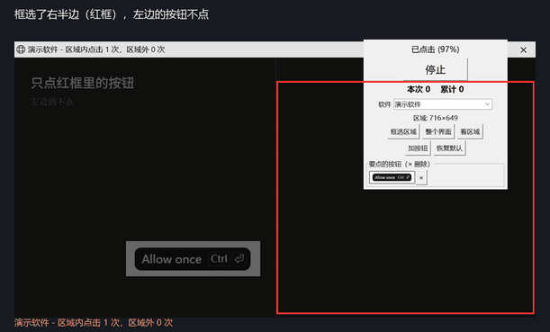
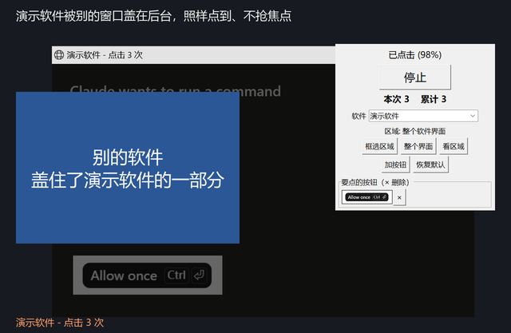
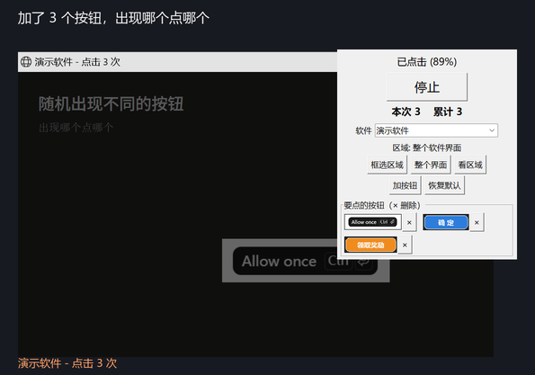
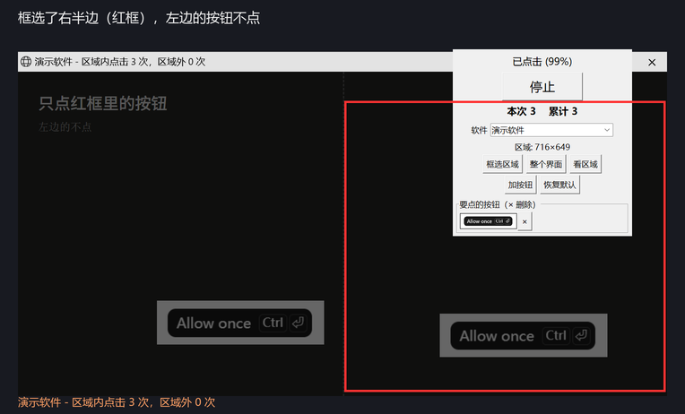

# 自动点击

在软件界面里找到和你给的截图 **≥80% 相似** 的地方，自动点一下。玩游戏、点确认按钮都行。


- 软件在后台、被别的窗口盖住也能点（不动真实鼠标）
- **不会把软件拉到前台**，不抢你正在用的窗口
- 可加多个按钮，出现哪个点哪个；按钮列表带缩略图，× 删除
- 可框选只检测的区域，点「看区域」在软件上闪红框
- 界面显示 **本次** 和 **累计** 点击数（点完按钮消失才算一次）
- 单文件 exe 17MB，不依赖 OpenCV

## 下载
[Releases](https://github.com/cdh66666/auto-click/releases) 里下载 `自动点击.exe`，双击运行。

## 使用
1. 「软件」下拉选要点的软件（也可手填进程名或窗口标题关键字）。
2. 点「加按钮」，在软件上框出要点的按钮。可以加多个。
3. 点「开始」。

需要时：「框选区域」只在框里找，「看区域」看框在哪，「整个界面」取消框选，「恢复默认」清空自己加的按钮。


## 效果

### 1. 软件被盖在后台，照样点到
演示软件被蓝色窗口盖住一部分，自动点击仍然点中按钮，前台窗口不变。


### 2. 多个按钮，出现哪个点哪个
加了 3 个按钮（Allow once / 确定 / 领取奖励），随机出现，全部点中。



### 3. 框选区域，只点框里的
框选右半边（红框）。左右同时有按钮，只点右边的：**区域内 8 次，区域外 0 次**。



### 检测
多尺度模板匹配，标出相似度：


| 后台点击 | 多按钮 | 框选区域 |
|---|---|---|
|  |  |  |

视频：[后台点击](docs/demo.mp4) · [多按钮](docs/multi.mp4) · [框选区域](docs/region.mp4)

## 测试结果
| 测试 | 结果 |
|---|---|
| `tests/e2e_background.py` 软件被遮挡时点击 | 9 秒点中 4–5 次 |
| `tests/e2e_count.py` 计数 = 按钮消失次数 | 点 8 次消失 8 次，计数 8；按钮点了不消失（`--stuck`）计数 0 |
| `tests/e2e_focus.py` 每 10ms 采样前台窗口 | 被拉到前台 **0** 次，前台窗口变化 **0** 次 |
| `tools/make_demo_media.py` 三个场景 | 后台 8/8、多按钮 8/8、区域内 8 次 / 区域外 0 次 |
| numpy 匹配 vs OpenCV `TM_CCOEFF_NORMED` | 位置一致，相似度差 < 1e-6 |

运行测试会弹出演示窗口，每个约 15 秒。

## 原理
1. `PrintWindow` 截取目标窗口画面（被遮挡也行）
2. 多尺度模板匹配（`imgmatch.py`，numpy + FFT 实现的归一化相关）
3. `PostMessage` 给窗口投递鼠标消息，不动真实鼠标；如果软件自己跳到前台，马上把前台和层叠顺序还原

## 自己打包
```
pip install -r requirements.txt
python build.py
```

## 许可
MIT
